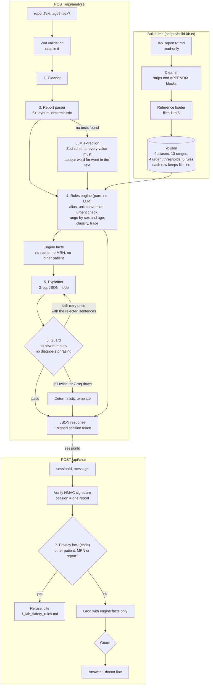

# Samjho

*Samjho* means "understand" in Urdu. (The repository and Vercel project keep the working name `labsaathi`.)

**Your lab report, in words you actually understand.**
Tech Fusion '26 AI Hackathon, Problem Statement B: Medical Lab Report Explainer.

| | |
| :--- | :--- |
| **Live app** | https://techfusion.wyibe.com (also https://labsaathi.vercel.app) |
| **Live test results** | https://labsaathi.vercel.app/evals |
| **API** | `POST https://labsaathi.vercel.app/api/analyze` |
| **Health** | https://labsaathi.vercel.app/api/health |

Samjho reads a CityLab report, checks every value against the lab's own reference sheets, shows its working with file citations, and explains the result in plain English or Roman Urdu. A tested rules engine decides normal, low, high and urgent. The language model only words the explanation, and its text is checked before anyone sees it.

---

## 1. Problem summary

CityLab publishes 14 patient reports and 6 reference files (safety rules, glossary, urgent values, three range sheets). Every file is about 2,000 words long, and about 96% of that is repeated legal and compliance boilerplate. The task is a bot that explains one patient's results in plain language and gets the hard parts right:

| Organiser checkpoint | What Samjho does | Where |
| :--- | :--- | :--- |
| 1. Match names and units | Resolves aliases through the glossary (SGPT, SGOT, FBS, Hb, PLT, RBC, WBC, any letter case). Converts units before comparing and shows the conversion as a step. | `src/lib/engine.ts` |
| 2. Handle edge cases | A value exactly on a limit is NORMAL. Age bounds are inclusive. Missing or unreadable age or sex triggers a question, never a guess. Sex is never read from a name. | `src/lib/engine.ts`, `src/lib/parser.ts` |
| 3. Admit what it cannot classify | No range in the files, an age outside the sheets, or a unit that cannot be converted gives "cannot be classified from the files". | `src/lib/engine.ts` |
| 4. Protect privacy | A session is cryptographically bound to one report. A message that names another patient, MRN or report is refused in code before any model call, and the refusal cites `1_lab_safety_rules.md`. | `src/lib/privacy.ts`, `src/lib/session.ts` |
| 5. Doctor questions and urgent warnings | Urgent thresholds from file 3 are checked after unit conversion. Urgent results carry a direction and "See a doctor today". Every explanation comes with 3 to 5 questions for the doctor. | `src/lib/engine.ts`, `src/lib/explain.ts` |

The only knowledge source is `lab_reports/`. Those files are never edited. No range, alias or threshold is typed into code: they are parsed from the files at build time.

---

## 2. Architecture

The main idea: **the LLM never classifies and never sees raw data.** Everything that can be decided by a rule is decided by a rule, and can be unit tested.



### The eight parts

1. **Cleaner** (`src/lib/cleaner.ts`). Removes everything from each `### APPENDIX` heading to the next `## ` heading or the end of the file. This drops 96.4% of the corpus. Line numbers of the surviving lines are kept, so citations point at the original file.
2. **Reference loader** (`src/lib/reference.ts`, run by `scripts/build-kb.ts`). Parses files 2 to 6 into typed tables: aliases, urgent thresholds, and ranges (test, sex, age min, age max, low, high, unit). It is driven by layout, not by file name: it understands markdown tables, nested bullets and inline bullets. Each row keeps its source file and line. A test (`tests/reference.test.ts`) checks that every number in the tables really appears on the line it cites.
3. **Report parser** (`src/lib/parser.ts`). Extracts name, age, sex, MRN and `{test, value, unit}` rows from: `- Name: 13.5 g/dL`, bold bullets, markdown tables with any header names in any column order, `Test: X` / `Result: Y` pairs, `Test Conducted` / `Value Recorded` pairs, `Name -> value`, and also `=`, dot leaders and wide-space columns. Bracketed placeholders (`[NOT PROVIDED]`, `[DATA CORRUPTED]`, any `[...]`), blanks and non-numeric ages are treated as missing. If it finds no tests at all, an LLM extraction runs into a Zod schema, and any value that does not literally appear in the cleaned text is rejected.
4. **Rules engine** (`src/lib/engine.ts`). Pure functions. Name resolution, unit conversion, urgent check, range selection, classification. Every step is written to a trace with a file citation.
5. **Explainer** (`src/lib/explain.ts`). The model receives only the engine output for the current patient (`src/lib/facts.ts`): no name, no MRN, no raw report, no other patient. It writes what each test measures, what low or high can be linked with, and 3 to 5 questions for the doctor, at a class 8 reading level.
6. **Guard** (`src/lib/guard.ts`). Checks the model's text before it is shown: no number that is not in the engine output, no diagnosis phrasing ("you have", "you are suffering from", disease verdicts, in English and Roman Urdu). The "only a licensed doctor can diagnose" line is attached by code to every reply. On failure the model gets one retry with the exact rejected sentences. If that fails too, a deterministic template is used.
7. **Privacy lock** (`src/lib/privacy.ts`, `src/lib/session.ts`). The session id is an HMAC-signed token that contains the engine facts of one report. The chat route verifies the signature, then checks the message in code for other MRNs, patient ids, report file names, "other patients" phrasing (English and Roman Urdu) and other people's names. A hit is refused before any model call.
8. **Reliability** (`src/lib/llm/groq.ts`). Timeout, exponential backoff with jitter on 429 and 5xx, `Retry-After` support, model fallback, a concurrency gate, and an in-memory cache keyed by a hash of the request. If Groq is fully down the app still returns every classification, with template explanations.

### Why no vector database

The organiser README suggests RAG. We measured the corpus first: after the cleaner runs, the whole knowledge base is 13 range rows, 9 aliases and 4 thresholds. That fits in a typed table. A table lookup is exact, testable and free. Embedding search over it could only add ways to be wrong, for example retrieving the female range for a male patient.

---

## 3. API

All input is validated with Zod. Errors are always JSON: `{ "error": { "code", "message", "details"? } }`.

### `POST /api/analyze`

```jsonc
// request
{ "reportText": "…full report text…", "age": 42, "sex": "female", "lang": "en", "explain": true }
```

Only `reportText` is required. `age` and `sex` fill gaps when the report does not give them. `lang` is `"en"` or `"roman-urdu"`. `explain: false` skips the model and returns the template explanation (fast path for bulk runs). A `text/plain` or `text/markdown` body is also accepted as the report itself, and the keys `report`, `text`, `content` and `gender` are accepted as spellings of the same fields, because the leaderboard format was not published when this was built.

```jsonc
// response (shortened)
{
  "patient": { "name": "Ethan Hunt", "age": 50, "sex": "male", "mrn": "CLD-P005-9942", "missing": [] },
  "results": [{
    "canonicalName": "Fasting Blood Sugar", "originalName": "Fasting Blood Sugar",
    "value": 6, "rawValue": "6.0", "unit": "mmol/L",
    "convertedValue": 108, "convertedUnit": "mg/dL",
    "conversion": { "formula": "6 mmol/L x 18 = 108 mg/dL", "factor": 18, "basis": "…" },
    "rangeUsed": { "low": 70, "high": 99, "unit": "mg/dL", "sex": "all", "ageMin": 18, "ageMax": 100,
                   "source": { "file": "5_ranges_biochemistry.md", "line": 4 } },
    "status": "high", "direction": "high", "urgent": false, "warning": null,
    "question": null, "missingFields": [], "matchedBy": "exact",
    "summary": "Fasting Blood Sugar: 6.0 mmol/L (= 108 mg/dL) is HIGH. Range used: 70 - 99 mg/dL (all sexes, age 18-100), from 5_ranges_biochemistry.md.",
    "trace": [{ "step": "conversion", "detail": "Unit conversion: 6 mmol/L x 18 = 108 mg/dL. …" }, "…"]
  }],
  "urgent": false, "urgentMessage": null,
  "needsInfo": [],
  "explanation": "plain text, always ends with the doctor line",
  "explanationDetail": { "overview": "…", "tests": [{ "test": "…", "measures": "…", "meaning": "…" }],
                         "source": "llm", "model": "openai/gpt-oss-120b", "guard": { "passed": true, "attempts": 1, "violations": [] } },
  "doctorQuestions": ["…", "…", "…"],
  "trace": ["…report-level steps…"],
  "sessionId": "signed token bound to this report",
  "meta": { "extraction": "deterministic", "explanationSource": "llm", "tokens": { "prompt": 0, "completion": 0, "total": 0 }, "timingsMs": { "engine": 0, "llm": 0, "total": 0 } }
}
```

`status` is one of `normal | low | high | abnormal | urgent | needs_info | unclassified`. `abnormal` is used for qualitative tests only (Urine Protein that is not "Negative").

### `POST /api/chat`

`{ "sessionId", "message", "lang"? }` returns `{ "reply", "refused", "reason", "source": "privacy-lock" | "llm" | "template", "citation" }`.

### Others

| Route | Purpose |
| :--- | :--- |
| `POST /api/explain` | `{ sessionId, lang }`: re-explain the same session in the other language. |
| `GET /api/health` | Model status, fallback model, retry and cache counters, knowledge-base counts. |
| `GET /api/samples`, `GET /api/samples/P001` | The 14 sample reports for the quick picks. |
| `GET /api/evals` | Runs the acceptance cases live against the deployed engine. |

---

## 4. Run it

### Locally

```bash
git clone https://github.com/ahmedmalik07/labsaathi.git
cd labsaathi
npm install
cp .env.example .env.local     # put your Groq key in it
npm run dev                    # http://localhost:3000
npm test                       # Vitest suite
```

`npm run dev`, `npm run build` and `npm test` all run `scripts/build-kb.ts` first, which regenerates `src/generated/kb.json` from `lab_reports/`. Without a `GROQ_API_KEY` the app still works: classifications are unaffected and explanations use the template.

### With Docker

```bash
cp .env.example .env           # put your Groq key in it
docker compose up --build      # http://localhost:3000
```

One container is enough: the Next.js server holds the UI, the API and the rules engine. There is no database and no vector store.

### Environment

| Variable | Meaning |
| :--- | :--- |
| `GROQ_API_KEY` | Groq free-tier key. Optional: without it the template explainer is used. |
| `GROQ_MODEL` | `openai/gpt-oss-120b`. Chosen from `GET /openai/v1/models`, supports JSON output. |
| `GROQ_FALLBACK_MODEL` | `openai/gpt-oss-20b`. Used when the first model is rate limited or failing. |
| `SESSION_SECRET` | Signs the session token. |
| `LABSAATHI_STRICT_NAMES` | `1` turns off context and normalised name matching (see Known failure cases). |

---

## 5. Test results

`npm test` runs **267 tests in 7 files, all passing** (about 0.8 s).

| File | What it covers |
| :--- | :--- |
| `tests/acceptance.test.ts` | 60 acceptance cases: the 14 sample reports, urgent thresholds, age limits, units and names, unseen layouts, privacy. The same list drives the live `/evals` page. |
| `tests/engine.test.ts` | Generated from the parsed tables: for every range row, both limits at both age bounds are normal, one step outside is low or high, ages one year outside are unclassified, the result cites the right file, and a missing sex gives a question. Every urgent threshold at exactly the limit, just inside, and far past. |
| `tests/reference.test.ts` | The loader output equals the generated knowledge base, and every number appears on the line it cites. |
| `tests/parser.test.ts` | 13 layouts, placeholders, all 14 sample files, noise lines that must be ignored. |
| `tests/privacy.test.ts` | 13 messages that must be refused, 8 that must be allowed. |
| `tests/demo.test.ts` | The three downloadable demo reports in `public/demo/` behave exactly as described below. |
| `tests/guard.test.ts` | Guard accepts and rejects, template passes its own guard for every sample in both languages, LLM extraction rejects invented values, session tokens cannot be spliced, backoff maths. |

The 14 sample reports:

| Report | Expected | Result |
| :--- | :--- | :--- |
| P001 Alice, F 28 | Hemoglobin 13.5 normal, WBC 6000 normal | pass |
| P002 Bob Jones, F 35 | SGPT 45 → ALT, female max 45, on the limit → normal | pass |
| P003 Charlie | age and sex missing → asks, no classification | pass |
| P004 Diana, F 42 | Hemoglobin 6.5 urgent (low), Platelets 120000 low | pass |
| P005 Ethan, M 50 | FBS 6.0 mmol/L → 108 mg/dL → high, conversion shown | pass |
| P006 Fiona | Serum Ferritin → cannot be classified from the files | pass |
| P007 George, M 65 | TSH 2.5 normal | pass |
| P008 Haley, F 19 | pH 5.5 normal, Protein Negative normal (matched by context) | pass |
| P009 Ian, M 48 | ALT 85 high, AST 60 high | pass |
| P010 Julia, F 55 | Cholesterol 200, on the limit → normal | pass |
| P011 Kevin, M 40 | WBC 12000 high, PLT 140000 low | pass |
| P012 Laura, 32, sex missing | AST 44 → asks for sex (normal for male, high for female) | pass |
| P013 Michael, M 45 | FBS 350 urgent (high) | pass |
| P014 Nancy, F 29 | FBS 85 normal, SGOT 22 → AST normal | pass |

Nothing in the engine or parser refers to a sample report, a patient name or a specific value. The sample expectations live only in `src/lib/evals.ts`, which the engine never imports.

---

## 6. Measured cost and response time

Measured with `node scripts/measure.mjs https://labsaathi.vercel.app` against the live deployment, all 14 sample reports, from a laptop in Pakistan. Times are full round trips as seen by the client.

### Response time

| Path | What happens | Round trip |
| :--- | :--- | :--- |
| Rules engine only, on the server | clean, parse, classify, trace | **0.3 to 2.4 ms** per report (9 ms on a cold instance) |
| Explanation already cached | engine + cache hit, no model call | median **0.93 s**, range 0.67 to 2.2 s |
| Fresh explanation from Groq | engine + 1 model call + guard | median **2.9 s**, range 2.2 to 5.5 s, one outlier at 12.6 s |

- The cached path shows what the network costs from our location: almost all of that 0.9 s is the connection to Vercel, not the app.
- The 12.6 s outlier was report P008. It still returned an LLM-written explanation. We did not confirm the cause; a rate-limit backoff or a cold start is the likely one.
- 10 of the 14 reports were fresh model calls in this run. The other 4 were already cached from an earlier aborted run, so they are counted in the cached row.
- Requests were sent 7 seconds apart to stay inside the free-tier tokens-per-minute limit. Sent faster, more of them would have fallen back to the second model or to the template.

### Cost per report

Groq's free tier costs **$0.00**. What a report spends is tokens from the per-minute budget:

| Case | Prompt tokens | Completion tokens | Total |
| :--- | :--- | :--- | :--- |
| Explanation accepted on the first attempt (8 of 10 fresh calls) | 659 to 748, average 701 | 257 to 422, average 328 | about **1,030** |
| Guard rejected the first attempt, one retry (2 of 10 fresh calls) | 1,621 to 1,747 | 486 to 590 | about **2,220** |
| Cached, or `explain: false`, or model down | 0 | 0 | **0** |

- Across all 14 reports the guard asked for a second attempt on 4 (P001, P003, P005, P013), mostly for the phrase "you have". All 14 ended with an LLM-written explanation that passed the guard. None needed the template in this run.
- At 8,000 tokens per minute per model, that is roughly 7 fresh explanations per minute on the first model and about the same again on the fallback model. Classifications are not limited by this at all.
- We did not put a dollar figure for a paid tier here because we could not verify a current price list. The token counts above are what you would multiply by it.

Reproduce with `node scripts/measure.mjs <base-url>`.

---

## 7. Rate-limit strategy

Groq's free tier allowed 8,000 tokens per minute per model when we built this (read from the `x-ratelimit-limit-tokens` response header). One explanation costs roughly 1,100 to 2,100 tokens, so one model alone covers only a handful of reports per minute. The design assumes the limit will be hit:

1. **The model is never on the critical path.** Classification, urgent warnings and the questions for missing age or sex come from the rules engine in about a millisecond. A rate limit can only change the wording of the explanation.
2. **Cache first.** Explanations are cached by a hash of the engine facts and language, and raw model calls by a hash of the request. The same report is never paid for twice on a warm instance.
3. **Backoff.** On 429, 5xx, timeout or network error: up to 2 retries per model, exponential backoff with jitter (400 ms base, 4 s cap), and `Retry-After` is honoured when it is short.
4. **Fall back instead of waiting.** If `Retry-After` is longer than 4 s, the model is put on a cool-down and the request goes straight to `GROQ_FALLBACK_MODEL`, which has its own token budget.
5. **Concurrency gate.** At most 4 model calls run at once per instance, so a burst queues instead of failing together.
6. **Time budget.** Each request has a total model budget (20 s for the first attempt, 12 s for the guard retry). When it runs out, the template is returned. A request never hangs.
7. **Template as the floor.** If both models fail, the deterministic template explanation is returned with HTTP 200 and `meta.explanationSource = "template"`, and `meta.llmError` says why.
8. **Our own limits.** `/api/analyze` allows 240 requests per minute per IP and `/api/chat` 40, answered with 429 and `Retry-After`. The analyze limit is deliberately generous so an automated grader is never blocked. Bulk clients can send `explain: false` to skip the model entirely.

`GET /api/health` reports calls, cache hits, retries, fallbacks and rate-limit responses for the running instance.

---

## 8. Decisions made along the way

These were judgement calls. Each is one switch or one function, so it is easy to change.

- **Leaderboard format unknown.** `POST /api/analyze` keeps a stable schema and accepts a few key spellings and plain-text bodies.
- **Urgent wording.** File 3 says results that "hit or pass" a threshold are urgent, while its table says "Less than" and "Greater than". We follow "hit or pass": a value equal to the threshold is urgent.
- **Urgent does not wait for demographics.** The thresholds in file 3 have no age or sex, so an urgent value is flagged even if sex is missing or the age is outside the sheets. The missing detail is still asked for.
- **What gets asked.** A test becomes `needs_info` only when its own range needs the missing field. Hemoglobin with sex missing asks for sex. Fasting Blood Sugar (one range for all sexes) with sex missing but age present is classified, and the report still notes that sex is missing.
- **A value printed in the report wins** over a value typed by the user. User input only fills gaps.
- **Glucose conversion.** mg/dL = mmol/L × 18, for Fasting Blood Sugar only. See Known failure cases.
- **Sessions are stateless signed tokens**, not server memory, so they survive Vercel cold starts and cannot be swapped for another patient's.
- **The model never gets the patient's name or MRN.** They are not needed to explain numbers.
- **Models.** `openai/gpt-oss-120b` with `openai/gpt-oss-20b` as fallback, both picked from Groq's live `/models` list. Both are open-weight models on the free tier. Nothing is fine-tuned.
- **No starter template.** The only scaffold is `create-next-app`. From its default config we removed `cacheComponents` and `partialPrefetching`, because the app is one static shell plus dynamic API routes.
- **Repository.** The organiser repo is kept as the `upstream` remote and its README is preserved in `docs/organizer-brief.md`.

---

## 9. Known failure cases

Honest list. These are the places where Samjho can be wrong or will refuse.

1. **The glucose conversion factor is not in the files.** The organiser README says reports use mmol/L, but no file gives the factor. We use mg/dL = mmol/L × 18 (from the hackathon brief), only for Fasting Blood Sugar, and the trace says the factor is not from the files. Cholesterol in mmol/L is *not* converted and comes back "cannot be classified from the files", because that factor is not in the files either.
2. **Urine test names are matched by context.** Report P008 says "pH Level" and "Protein". The glossary has neither, and the range sheet only has "Urine pH" and "Urine Protein". With strict mode off (default) Samjho matches them when the report text or file name mentions urine, or when *every* test on the report only fits urine tests and there are at least two. The trace says "matched by context". This can be wrong: a report that lists only "pH" and "Protein" from another specimen would be read as urine. A single "Total Protein" inside a liver panel is not matched. Set `LABSAATHI_STRICT_NAMES=1` to turn this off; P008 then returns "cannot be classified".
3. **"Hit or pass" versus "Less than".** File 3 contradicts itself. We treat a value equal to the threshold (Hemoglobin 7.0, FBS 300, Platelets 50000, ALT 1000) as urgent. If the grader reads the table literally, those four exact values will differ. It is one comparison in `isUrgent()`.
4. **Ages outside 18 to 100.** Every range in the files covers 18 to 100 only. A 17-year-old or a 101-year-old gets "cannot be classified from the files" for every range-based test. That is correct by the rules and unhelpful for children.
5. **Name matching beyond the glossary is shallow.** With strict mode off, plural endings, word order, filler words (count, level, total) and a leading Serum or Plasma are ignored, so "Platelets", "Blood Sugar (Fasting)", "Total Cholesterol" and "Serum ALT" match. Real synonyms that are not in the glossary do not: "Fasting Glucose", "Haemoglobin" (British spelling), "Thyroid Stimulating Hormone". "Random Blood Sugar" and "HDL Cholesterol" are correctly left alone. Unmatched names come back "cannot be classified", which is safe but can under-report. Ignoring "Serum" is a small step outside the glossary; strict mode turns it off.
6. **Units.** Only spelling variants (`cells/µL` = `cells/mcL`), metric rescaling (g/L → g/dL, 10^3/mcL → cells/mcL) and the glucose factor are handled. `IU/L` is not treated as `U/L`. A result with no unit is compared in the reference unit and the trace says so, which is wrong if the lab used another unit and did not print it.
7. **Qualitative results are compared literally.** The sheet says Urine Protein is "Negative". Anything else is abnormal, including "Nil", "Absent" or "Not detected", which a person would read as the same thing. The files do not say they are equal, so we do not assume it.
8. **Layouts the parser may miss.** Two results on one line ("Hb 13.5, WBC 6000"), values written as words, results inside a paragraph of prose, tables without a `|---|` divider row whose headers are not recognised, and names longer than 50 characters. A value with `<` or `>` is compared as the bare number. If nothing is found, LLM extraction runs, but it only keeps values that appear word for word in the text.
9. **Scanned or handwritten reports are not supported.** There is no OCR. Input must be text (`.md`, `.txt` or pasted).
10. **Roman Urdu quality.** Roman Urdu has no standard spelling and the model sometimes mixes in Hindi words or makes a factual slip in the "what it measures" sentence (we saw fasting sugar described as "after eating" once). The guard checks numbers and diagnosis phrasing, not general accuracy. Read-aloud for Roman Urdu uses whatever Urdu, Hindi or English voice the browser has, so pronunciation varies by device.
11. **The guard is a pattern check, not understanding.** It blocks "you have", "suffering from", disease verdicts and unknown numbers. A carefully worded sentence could still imply a diagnosis without those patterns. It also over-blocks: any reply containing "you have" is rejected even when harmless, which costs a retry and sometimes drops to the template.
12. **Template explanations are plain.** When the model is unavailable, the template restates the facts and does not describe what the test measures, because that would be outside medical knowledge typed into code.
13. **Privacy lock limits.** Names are detected next to words such as "report" or "results", plus every patient in the corpus. A bare first name with no cue ("what about Sara") can slip past the code check. It still cannot leak data: the model only ever holds the current patient's facts.
14. **Caches and rate limits are per server instance.** On Vercel each instance has its own memory, so the cache is cold after a cold start and the per-IP limit is approximate.
15. **Reference-file layouts.** The loader handles the three layouts in files 2 to 6. A new sheet in a different shape (for example ranges in prose) would be skipped, and the build prints the counts so that is visible.

---

## 10. Project structure

```
lab_reports/            the corpus (read-only, never edited)
scripts/build-kb.ts     build step: corpus -> src/generated/kb.json
scripts/measure.mjs     latency and token measurement against a running instance
src/lib/
  cleaner.ts            1. strips appendix boilerplate
  reference.ts          2. reference loader (aliases, ranges, urgent, rules)
  parser.ts             3. deterministic report parser
  extract.ts            3b. LLM extraction fallback, verified against the text
  engine.ts             4. rules engine (pure)
  facts.ts              what the LLM is allowed to see
  explain.ts            5. explainer (Groq + guard + retry)
  template.ts           deterministic explanation (English, Roman Urdu)
  guard.ts              6. output guard
  privacy.ts            7. privacy lock
  session.ts            signed session tokens
  llm/groq.ts           8. timeout, backoff, fallback, cache
  pipeline.ts           wires it together for /api/analyze
  evals.ts              acceptance cases shared by Vitest and /evals
  config.ts             every tunable decision in one file
src/app/api/            analyze, chat, explain, health, samples, evals
src/app/evals/          live pass/fail page
src/components/         UI: hero, result cards, tabs, print sheet
src/components/three/   React Three Fiber scenes (hero cells, test tube)
tests/                  Vitest suites
```

## 11. Frontend notes

- React Three Fiber and drei: an instanced mesh of biconcave red blood cells with depth fog and pointer parallax in the hero, and a 3D test tube on each result card. The liquid level shows where the value sits in its range (the two rings are the low and high limits) and the colour is the status. Urgent tubes pulse.
- 3D never blocks the product. It is loaded with `next/dynamic` and `ssr: false` after first paint. The first paint is always a static gradient and SVG tubes. 3D stays off for `prefers-reduced-motion`, data saver, low-power devices and browsers without WebGL, and switches itself off if the frame rate drops. Only the first 6 cards get a WebGL tube.
- Look: warm paper background, ink text, one orange accent, a serif display face (Cormorant Garamond) with Figtree for text. Status colours: green normal, amber low or high, red urgent, grey cannot classify, blue needs info.
- The page tells a short story below the tool: the report as it arrives, the confusion, the 2 a.m. search, and the same report read against the lab's sheets.
- Roman Urdu toggle, read-aloud (browser Web Speech API), and a printable "Questions for my doctor" sheet.

## 12. Demo reports

Three extra reports for a live demo are in `public/demo/` and can be downloaded from the home page. They are new patients, not part of the corpus, and the engine has no special knowledge of them.

| File | What it shows |
| :--- | :--- |
| `demo_1_ayesha_full_checkup.md` | All seven kinds of test in one table. Hb 6.8 is urgent, PLT 148000 is low, SGPT 45 and Cholesterol 200 sit exactly on the limit and are normal, FBS 5.2 mmol/L converts to 93.6 mg/dL, TSH 4.6 is high. |
| `demo_2_bilal_missing_details.md` | Age and sex are missing, so nothing is labelled and the app asks. Answer "male, 40" and SGOT 44 is normal; answer "female" and it is high. |
| `demo_3_sana_messy_layout.md` | No markdown, mixed separators, "Age/Sex: 52/F". FBS 17 mmol/L becomes 306 mg/dL and is urgent. Ferritin, RBC and Cholesterol in mmol/L come back "cannot be classified". Urine Protein "Trace" is abnormal. |

## 13. Hackathon rules

- Knowledge source: `lab_reports/` only, untouched. Classifications use no outside medical knowledge.
- AI: Groq free tier, open-weight models, no fine-tuning.
- Code: written for this hackathon. `create-next-app` is the only scaffold.
- Secrets: `.env*` is git-ignored. Keys live in Vercel environment variables.

*Samjho explains numbers. Only a licensed medical doctor can diagnose conditions.*
